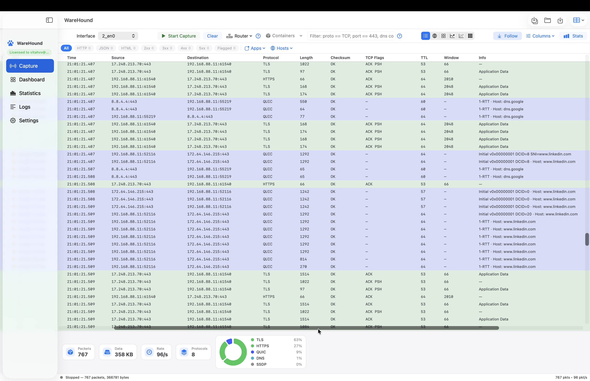
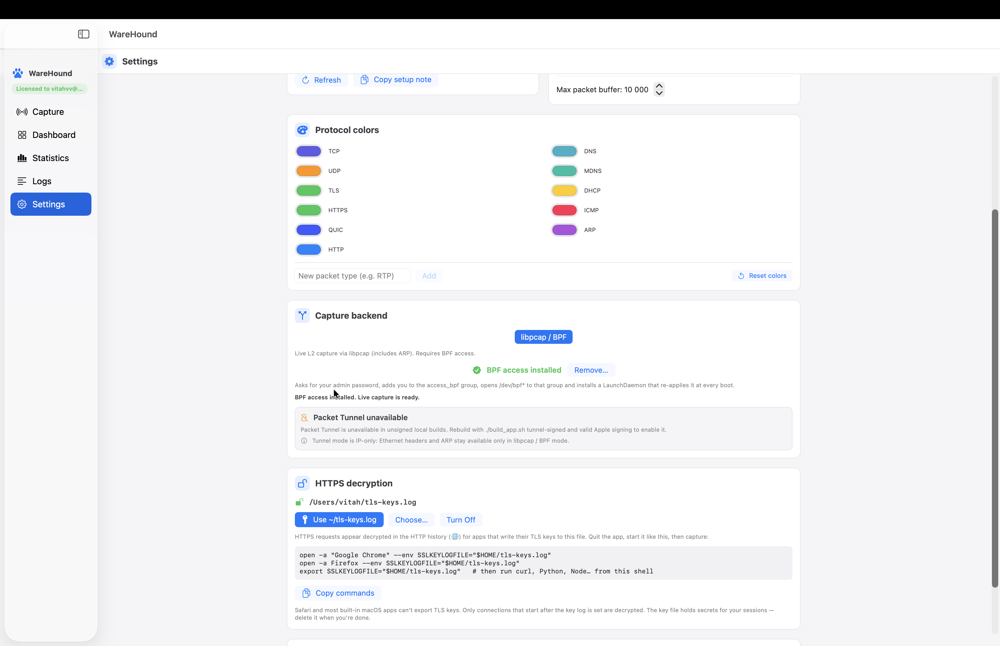
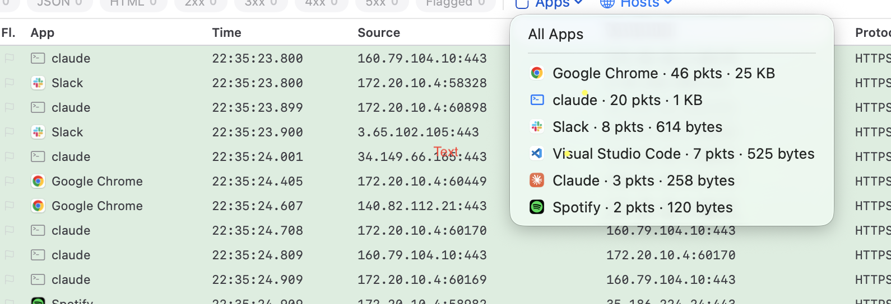
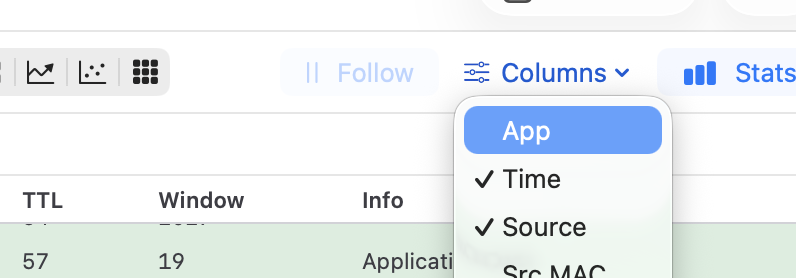
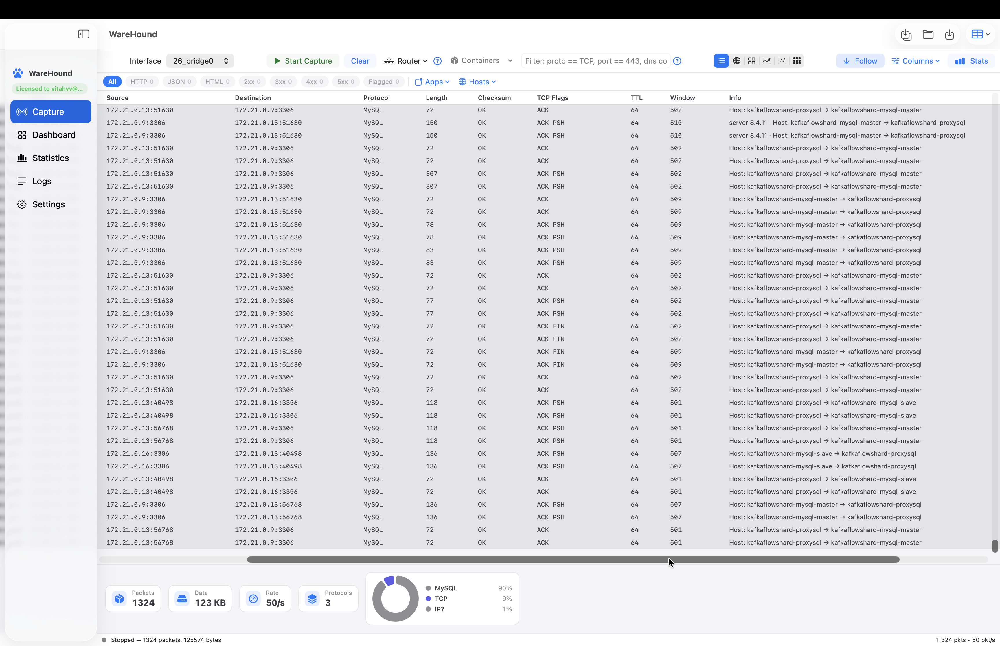
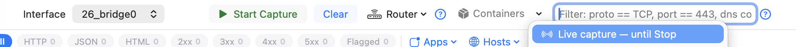

# WareHound for macOS

A native macOS packet analyzer written in Swift/SwiftUI on top of `libsniffer`
(C++ on libpcap). It captures live traffic from your Mac's interfaces or from
Docker containers, decodes it, and lets you filter, follow streams, read HTTP
history, and decrypt TLS.

> [!IMPORTANT]
> **Installing from the DMG?** The app is ad-hoc signed and not notarized, so
> macOS reports it as "damaged" or "from an unidentified developer" on first
> launch. After dragging WareHound to **Applications**, run this once in Terminal,
> then open the app normally:
>
> ```sh
> xattr -dr com.apple.quarantine /Applications/WareHound.app
> ```
>
> Repeat it after installing a newer DMG. Live capture also needs one-time BPF
> access, described in [Kernel access for capture](#kernel-access-for-capture-one-time).



## Requirements

- macOS 14 (Sonoma) or newer, Apple Silicon
- Xcode 15+ with command line tools
- CMake: `brew install cmake`
- OpenSSL and nghttp2 for TLS/HTTP2 decryption: `brew install openssl@3 libnghttp2`
- Docker Desktop, only for container capture

libpcap ships with macOS.

## Build and run

From the `WareHound-macOS` folder:

```sh
./build_app.sh
open ~/Library/Developer/Xcode/DerivedData/WareHound-*/Build/Products/Debug/WareHound.app
```

The script builds `libsniffer` with CMake, copies it to `Frameworks/libsniffer.dylib`,
and builds an unsigned Debug app with `xcodebuild`.

To build a distributable DMG instead, run `scripts/make_dmg.sh`. The result lands in
`dist/`. The GitHub workflow builds the same DMG on every push and attaches it to
releases tagged `v*`.

After installing from a DMG, remove the quarantine flag as described in the
notice at the top of this page, otherwise macOS refuses to open the app.

## Kernel access for capture (one-time)

Live capture reads the BPF devices `/dev/bpf*`, which macOS restricts to root.
WareHound can grant itself access without running as root.

**In the app (recommended).** Open **Settings** and find the **Capture backend**
card shown below. Click **Install BPF access…** (the button sits where the green
"BPF access installed" badge is in the picture). macOS asks for your
administrator password once, the badge turns green, and live capture is ready to
run.



The **Packet Tunnel unavailable** box in the same card can be ignored. It only
concerns signed builds, and libpcap / BPF is the backend this guide uses.

The installer then:

1. creates the `access_bpf` group if needed and adds your user to it,
2. changes `/dev/bpf*` to that group with read/write permission,
3. installs the LaunchDaemon `com.warehound.chmodbpf`, which re-applies step 2
   at every boot so the access survives reboots.

Log out and back in once so your session picks up the new group. The same card
shows the device count and whether the devices are readable and writable, and
**Remove…** undoes the installation.

**By hand.** The equivalent shell steps. Run them from the root of this
repository, the folder that contains `WareHound-macOS/`, because the `cp` lines
use paths relative to it:

```sh
cd /path/to/WareHound_mac   # your clone of this repository

# 1. Group: create it only if it does not exist yet, then join it.
dseditgroup -o read access_bpf >/dev/null 2>&1 || sudo dseditgroup -o create access_bpf
sudo dseditgroup -o edit -a "$USER" -t user access_bpf

# 2. Boot-time helper that opens /dev/bpf* to the group.
sudo mkdir -p "/Library/Application Support/WareHound"
sudo cp WareHound-macOS/scripts/warehound-chmod-bpf.sh "/Library/Application Support/WareHound/"
sudo chmod 755 "/Library/Application Support/WareHound/warehound-chmod-bpf.sh"
sudo cp WareHound-macOS/scripts/org.warehound.ChmodBPF.plist /Library/LaunchDaemons/
sudo chown root:wheel /Library/LaunchDaemons/org.warehound.ChmodBPF.plist
sudo chmod 644 /Library/LaunchDaemons/org.warehound.ChmodBPF.plist

# 3. Start it now; it also runs at every boot.
sudo launchctl bootstrap system /Library/LaunchDaemons/org.warehound.ChmodBPF.plist
```

Check the result with `ls -l /dev/bpf0`. It should show `crw-rw----` and the
group `access_bpf`. Log out and back in once so your session picks up the group.

The manual steps install the daemon `org.warehound.ChmodBPF`, while the in-app
installer uses `com.warehound.chmodbpf`. Either one is enough; you do not need
both. Wireshark's ChmodBPF helper does the same job if you already have it.
As a quick test you can also run the binary with `sudo`, but the app then writes
its settings as root.

## Capture

The screenshot shows a live capture on `en0`. From left to right, the toolbar has:

- **Interface** picker and **Start Capture** (⌘R). Press it again to stop.
  **Clear** empties the list.
- **Router** menu: quick filters for traffic that goes through your router. See
  **Working with the Router menu** below.
- **Containers**: Docker capture, described below.
- **Filter** field for the display filter. Examples:

  ```
  proto == TCP and port == 443
  proto == TCP && checksum != bad
  http contains example.com
  method == GET
  dhcp == Discover
  arp contains 192.168.1.1
  quic == true
  mdns contains local
  ```

  Plain text search works too.
- **View modes**: packet table, HTTP history (globe), cards, compact sparklines,
  timeline swimlanes, and a JA3-style TLS fingerprint heatmap.
- **Follow** keeps the table scrolled to the newest packet. **Columns** shows or
  hides columns (MAC, checksum, TCP flags, TTL, window, VLAN, QoS, ICMP, seq/ack).
  **Stats** toggles the live statistics panel at the bottom.

The row of chips under the toolbar is the quick filter: **HTTP**, **JSON**,
**HTML**, status classes **2xx** to **5xx**, and **Flagged**. A chip selects whole
flows, so the packet table keeps every packet of a connection that carried a
matching exchange. The **Hosts** menu narrows the table to one host. Rows are
colour-coded by protocol, and the donut at the bottom shows the protocol mix of
the capture.

### Working with the Router menu

The **Router** menu in the toolbar filters the capture down to what passes
through your gateway. WareHound reads the default gateway from the system and
writes a ready-made expression into the filter field, so you can see it, edit it,
or combine it with your own terms. It has three entries:

- **Routed via gateway (MAC)**: fills in `mac == <router MAC>`, matching every
  packet whose Ethernet source or destination is the router. That is all traffic
  leaving or entering your network.
- **Addressed to the router (IP)**: fills in `ip == <gateway IP>`, matching only
  packets sent to or from the router itself, such as DNS queries when the router
  is your resolver, DHCP, and its web admin.
- **Show all traffic (clear filter)**: empties the filter field. Choosing the
  same entry a second time also clears it.

The **?** button next to the menu lists what to expect: ARP from your Mac
resolving the gateway, DHCP Discover/Offer/Request/ACK, DNS, the router's HTTP or
TLS admin interface, and broadcast or multicast such as mDNS and SSDP. On a
switched Wi-Fi or Ethernet network the capture sees your own host's traffic plus
broadcasts, not other devices' unicast, unless you use a mirror port. The menu
turns blue while a router filter is active.

### App column and the Apps menu



During a live capture of your Mac's own traffic, WareHound looks up which local
process owns each TCP or UDP flow. The **App** column, on by default, shows that
application's icon and name on every row, as in the picture.

To turn the App column off, or back on, use either of these. Both remember the
choice across launches:

- **Columns** menu in the Capture toolbar: untick **App**, as in the picture below.
- **Settings**, **Packet columns** card: switch off **App**.



The **Apps** menu above the table lists every application seen so far with its
packet count and bytes, largest first. Click an app to show only its traffic; the
menu label changes to the app name and turns blue. Click **All Apps** to go back
to everything. Right-clicking a row offers the same via **Filter by App**.
Command-line tools without an app bundle, such as `claude` in the picture, appear
with a terminal icon. Container traffic from Docker captures is attributed to the
container name instead.

Right-click a packet for **Open Details** (decoded fields and hex dump),
**Follow Stream**, a colour flag, **Filter by App**, **Filter by Host**, and
**Copy Row / Info / SNI / Fingerprint**. The window toolbar opens and saves
`.pcap` files, exports packets as PCAP, CSV or JSON, and saves a snapshot to the
Dashboard.

### Reading the Info column: TLS, HTTPS and QUIC

The **Info** column is where encrypted traffic becomes readable at a glance. In
the screenshot above:

- **TLS** rows show the record type, such as `Application Data`. The ClientHello
  carries the server name, and **Copy SNI** puts it on the clipboard. The
  fingerprint heatmap groups connections by their JA3-style ClientHello
  fingerprint over time.
- **HTTPS** rows are packets on port 443 (also 5001 and 8443) that carry no TLS
  record, typically bare ACKs. The label comes from the port alone.
- **QUIC** rows need no key log to be labelled. WareHound derives the Initial
  secrets from the connection ID, as RFC 9001 describes, and decrypts the
  Initial packet on the fly. The row then shows the version, the DCID length and
  the server name and ALPN found in the ClientHello, for example
  `Initial v0x00000001 DCID=8 SNI=www.linkedin.com`. Later short-header packets
  are shown as `1-RTT · Host: www.linkedin.com`, carrying the host learnt from
  the handshake. Payload bytes of 1-RTT packets are not decrypted.

To filter on this, type `quic == true`, `port == 443`, or a host name such as
`linkedin` into the filter field.

### Decrypting HTTPS

TLS payload decryption needs the session keys. Apps that honour the
`SSLKEYLOGFILE` variable (Chrome, Firefox, curl, Python, Node and others) write
them to a file. Safari and most built-in macOS apps cannot export keys.

1. Open **Settings** and press **Use ~/tls-keys.log** in the **HTTPS decryption**
   card, or **Choose…** an existing key log. The card also offers
   **Copy commands** for the launch lines below.
2. Quit the client app and start it with the key log set, for example:

   ```sh
   open -a "Google Chrome" --env SSLKEYLOGFILE="$HOME/tls-keys.log"
   open -a Firefox --env SSLKEYLOGFILE="$HOME/tls-keys.log"
   export SSLKEYLOGFILE="$HOME/tls-keys.log"   # then run curl, Python, Node… from this shell
   ```

3. Start the capture. Only connections that begin after the key log is set can
   be decrypted.

Decrypted exchanges appear in two places:

- **HTTP history** (the globe view mode) lists every request and response, plain
  or decrypted, with method, host, status, size and content type. Select a row
  to see the **Request** and **Response** panes with headers and body as
  **Text**, **Hex**, **List** or rendered **HTML**. Chunked framing and
  gzip/deflate are removed. HTML renders offline with scripts and network loads
  blocked. Encrypted connections without keys are still listed by host.
- **Follow Stream** rebuilds one TCP conversation. Its **TLS** bar shows the key
  log in use (**Choose SSLKEYLOGFILE…** picks another one) and **Decrypt**
  rebuilds the stream. Turn on **Decrypted** to read the plaintext, switch
  between ASCII and hex, filter by direction, and see HTTP/2 frames and gRPC
  messages decoded. **Export Protobuf…** and **Save Payload…** write the data
  to disk.

The key log holds secrets for your sessions. Press **Turn Off** in Settings and
delete the file when you are done.

## Docker container capture



On macOS, Docker Desktop runs containers inside a Linux VM, so their traffic never
reaches `en0`. WareHound starts a small helper container
(`nicolaka/netshoot` running `tcpdump -i any` with `--net=host --privileged`)
inside that VM and streams the packets back into the app. No BPF access or
`sudo` is needed for this mode.

> [!IMPORTANT]
> **Capturing Docker containers?** Two steps, both shown in the picture below:
>
> 1. Switch the **Interface** picker at the left of the toolbar to the `bridge`
>    interface. Leave it on `en0` and you will see your Mac's own traffic, not
>    the containers'.
> 2. Open the **Containers** menu (the arrow next to the button) and choose
>    **Live capture — until Stop**.
>
> 
>
> Container traffic then streams in until you press **Stop Capture**.

The screenshot shows a capture of a Kafka/MySQL stack: the **Protocol** column
labels port 3306 as MySQL, and the **Info** column resolves container IPs to
their names, such as `kafkaflowshard-proxysql → kafkaflowshard-mysql-master`,
together with the MySQL server version seen in the greeting.

**Before you start**

1. Start Docker Desktop and your containers. `docker ps` should list them.
2. Optionally pull the helper image once so the first capture does not wait:

   ```sh
   docker pull nicolaka/netshoot
   ```

**Live capture.** Select the `bridge` interface in the **Interface** picker, then
open the **Containers** menu and choose **Live capture — until Stop** (clicking
the **Containers** button itself does the same). WareHound detects the Docker
bridge networks and captures all container traffic, including containers that
expose no ports, until you press **Stop Capture**.

**Timed capture.** Open the **Containers** menu and pick
**Auto-detect · bounded window → Capture 5 s / 10 s / 30 s** to record for a
fixed time. Use this on busy stacks so the capture stays small.

**Specific services.** **Containers → Filter preset (10 s)** records only the
listed ports:

| Preset | Ports |
|---|---|
| Common services | 6379, 9092, 29092, 8080, 8000, 5432, 3306, 27017, 5001 |
| Databases (SQL/Mongo) | 5432, 3306, 27017, 1433 |
| Messaging (Kafka/Redis) | 9092, 29092, 6379 |
| HTTP | 8080, 8000, 5001, 8081 |
| All TCP | all TCP traffic |

**Ports only (quieter)** limits the capture to the containers' published ports,
which drops health checks and heartbeats. **Edit protocol labels…** names your
own ports in the Protocol column, for example `8000 → Kafka`.

After the capture, everything works as for a local capture: display filters such
as `port == 3306`, **Follow Stream**, **Statistics**, **Save pcap** and
**Export**.

A command-line alternative writes a `.pcap` to your home folder, which you can
load with **Open pcap**:

```sh
WareHound-macOS/scripts/capture-containers.sh [seconds] [maxPackets] [bpf filter...]
WareHound-macOS/scripts/capture-containers.sh 20 10000 tcp port 9092 or tcp port 6379
```

## Other sections

- **Dashboard**: saved capture snapshots. Review, export CSV, or delete.
- **Statistics**: protocol and port breakdown, top talkers, top apps with bytes
  sent and received, TCP connection health (RTT, retransmits), and ARP, DHCP,
  HTTP, mDNS and QUIC details. Export as CSV or JSON.
- **Logs**: the app log with level filter and search.
- **Settings**: time format, theme, columns, protocol colours, kernel-level BPF
  capture filter (for example `tcp port 443`), packet buffer size, BPF access,
  and HTTPS decryption.

## License and copyright

Copyright © 2025 [sonne120](https://github.com/sonne120). All rights reserved.

WareHound is proprietary software. The app runs as a free 10-day trial; after
that a license key is required, which you enter in the app's license dialog
(click the license badge at the top of the sidebar). The source code is published
in this repository for reference and review only. No permission is granted to
copy, modify, redistribute, or sell WareHound or any part of it, in source or
binary form, without the written consent of the author.

WareHound links against libpcap and libz from macOS, and against OpenSSL,
nghttp2 and the `nicolaka/netshoot` Docker image, each under its own license.
